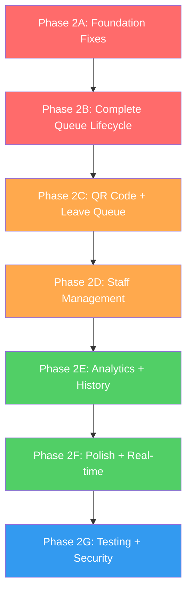

# QueueLess — Phase 2 Build Guide

> **Who this is for**: The AI building QueueLess. This is your senior developer telling you exactly what to build next, in what order, how to build it correctly, and what traps to avoid. Follow it precisely. Do not skip steps. Do not improvise the order. **Every section ends with a verification step — do not move on until it passes.**

---

## Current State Assessment

### What works (after RLS fix)
- ✅ Auth: signup, login, logout
- ✅ Business creation (with auto-created "Main queue")
- ✅ Queue pause/resume
- ✅ Customer join via public page `/q/[slug]`
- ✅ Ticket tracking page `/ticket/[token]`
- ✅ Call Next (staff)
- ✅ Realtime refresh (crude but functional)
- ✅ RLS policies (after the SECURITY DEFINER fix)

### What's broken or missing
- ❌ QR code generation — dependency installed, never used
- ❌ Customer leave queue — documented, not built
- ❌ Individual ticket status changes (Mark Ready, Mark Served, No Show, Cancel) — only "Call Next" works from UI
- ❌ Queue editing/deletion
- ❌ Business settings/branding editing
- ❌ Staff management (add/remove staff)
- ❌ Analytics dashboard
- ❌ Queue history view
- ❌ Error boundaries
- ❌ Loading states on most forms
- ❌ Tests — zero
- ❌ Rate limiting
- ❌ Proper realtime (uses `window.location.reload()`)

---

## Build Order: The Critical Path

> [!IMPORTANT]
> Build features in this exact order. Each step depends on the previous. Do NOT skip ahead to "fun" features like analytics before the core queue lifecycle is bulletproof.



---

## Phase 2A: Foundation Fixes (Do First, No Excuses)

These are not features. These are things that should already exist. Fix them before writing a single new feature.

### 2A-1: Set Up Prettier

```bash
npm i -D prettier
```

Create `.prettierrc`:
```json
{
  "semi": true,
  "singleQuote": false,
  "trailingComma": "none",
  "printWidth": 120,
  "tabWidth": 2
}
```

Add script to `package.json`:
```json
"format": "prettier --write \"src/**/*.{ts,tsx,css}\""
```

Run `npm run format`. Commit the result. **Every file should be readable now — no more single-line JSX.**

**Verify**: Open any `.tsx` file. JSX should be properly indented across multiple lines.

---

### 2A-2: Error Boundaries

Create `src/app/error.tsx`:
```tsx
"use client";

import { useEffect } from "react";

export default function Error({ error, reset }: { error: Error; reset: () => void }) {
  useEffect(() => {
    console.error("Unhandled error:", error);
  }, [error]);

  return (
    <main className="page">
      <div className="card" style={{ maxWidth: 520, margin: "0 auto", textAlign: "center" }}>
        <h1>Something went wrong</h1>
        <p className="muted">{error.message || "An unexpected error occurred."}</p>
        <button className="button" onClick={reset}>Try again</button>
      </div>
    </main>
  );
}
```

Create `src/app/not-found.tsx`:
```tsx
import Link from "next/link";

export default function NotFound() {
  return (
    <main className="page">
      <div className="card" style={{ maxWidth: 520, margin: "0 auto", textAlign: "center" }}>
        <h1>Page not found</h1>
        <p className="muted">The page you are looking for does not exist or has moved.</p>
        <Link className="button" href="/">Go home</Link>
      </div>
    </main>
  );
}
```

**Verify**: Navigate to `localhost:3000/thispagedoesnotexist`. Should show the custom 404 page, not a white screen.

---

### 2A-3: Create Service Layer

Create `src/lib/services/` directory. Extract business logic from API routes.

**File: `src/lib/services/business.ts`**
```typescript
import { SupabaseClient } from "@supabase/supabase-js";

export async function createBusiness(
  supabase: SupabaseClient,
  userId: string,
  input: { name: string; slug: string }
) {
  const { data: business, error } = await supabase
    .from("businesses")
    .insert({ ...input, owner_id: userId })
    .select("id,name,slug")
    .single();

  if (error) throw new Error(error.message);

  const { error: queueError } = await supabase
    .from("queues")
    .insert({
      business_id: business.id,
      name: "Main queue",
      slug: `${input.slug}-main`,
      status: "ACTIVE"
    });

  if (queueError) throw new Error(queueError.message);

  return business;
}
```

**File: `src/lib/services/queue.ts`**
```typescript
import { SupabaseClient } from "@supabase/supabase-js";

export async function callNext(supabase: SupabaseClient, queueId: string) {
  const { data, error } = await supabase
    .rpc("call_next", { target_queue_id: queueId })
    .single();
  if (error) throw new Error(error.message);
  return data;
}

export async function changeQueueStatus(
  supabase: SupabaseClient,
  queueId: string,
  status: "ACTIVE" | "PAUSED"
) {
  const { data, error } = await supabase
    .from("queues")
    .update({ status })
    .eq("id", queueId)
    .select("id,status")
    .single();
  if (error) throw new Error(error.message);
  return data;
}

export async function changeTicketStatus(
  supabase: SupabaseClient,
  ticketId: string,
  status: string
) {
  const { data, error } = await supabase
    .rpc("change_ticket_status", {
      target_ticket_id: ticketId,
      next_status: status
    })
    .single();
  if (error) throw new Error(error.message);
  return data;
}
```

Then refactor API routes to use these services. Keep routes thin — validate input, call service, return response.

**Verify**: All existing functionality still works after refactor (login, create business, join queue, call next).

---

### 2A-4: Generate and Use Supabase Types

If you have the Supabase CLI:
```bash
npx supabase gen types typescript --project-id czbsjyjvzxlkxberambp > src/lib/database.types.ts
```

If not, manually create types that match the actual schema. Then use them:
```typescript
import { createBrowserClient } from "@supabase/ssr";
import type { Database } from "./database.types";

export function getBrowserSupabase() {
  return createBrowserClient<Database>(url, anonKey);
}
```

Delete the unused types in `src/lib/types.ts` or replace them with the generated ones.

**Verify**: TypeScript catches a wrong column name if you typo one in a `.select()` call.

---

### 2A-5: Clean Up Dead Dependencies

```bash
npm uninstall qrcode @types/qrcode
```

You will re-install `qrcode` in Phase 2C when you actually implement QR generation. Until then, it's dead weight.

**Verify**: `npm ls qrcode` returns "empty".

---

## Phase 2B: Complete Queue Lifecycle

Right now, staff can only "Call Next". They can't mark tickets as Ready, Served, No Show, or Cancel them individually. This is the most critical missing feature — the demo script requires it.

### 2B-1: Add Ticket Action API Route

Create `src/app/api/tickets/[id]/status/route.ts`:
```typescript
import { NextResponse } from "next/server";
import { z } from "zod";
import { getServerSupabase } from "@/lib/supabase";
import { changeTicketStatus } from "@/lib/services/queue";

const schema = z.object({
  status: z.enum(["CALLED", "READY", "SERVED", "NO_SHOW", "CANCELLED"])
});

export async function POST(
  request: Request,
  { params }: { params: Promise<{ id: string }> }
) {
  const { id } = await params;
  try {
    const input = schema.parse(await request.json());
    const supabase = await getServerSupabase();
    const { data: { user } } = await supabase.auth.getUser();
    if (!user) {
      return NextResponse.json({ error: "You must be logged in." }, { status: 401 });
    }
    const ticket = await changeTicketStatus(supabase, id, input.status);
    return NextResponse.json({ ticket });
  } catch (error) {
    return NextResponse.json(
      { error: error instanceof Error ? error.message : "Unable to update ticket." },
      { status: 400 }
    );
  }
}
```

**Verify**: `POST /api/tickets/{ticketId}/status` with `{"status": "SERVED"}` returns the updated ticket. Invalid transitions (e.g., `SERVED → WAITING`) return an error.

---

### 2B-2: Add Ticket Action Buttons to Queue Controls

Update `queue-controls.tsx` (or better, create a `ticket-row.tsx` component). Each ticket in the queue should have contextual action buttons based on its current status:

| Current Status | Available Actions |
|---|---|
| `WAITING` | Call, Cancel |
| `CALLED` | Ready, Served, No Show |
| `READY` | Served, No Show |

```tsx
// src/app/dashboard/queues/[id]/ticket-row.tsx
"use client";

import { useState } from "react";

type TicketRowProps = {
  ticket: {
    id: string;
    token: string;
    customer_name: string;
    party_size: number;
    status: string;
    joined_at: string;
  };
};

const ACTIONS: Record<string, { label: string; status: string; style?: string }[]> = {
  WAITING: [
    { label: "Call", status: "CALLED" },
    { label: "Cancel", status: "CANCELLED", style: "danger" }
  ],
  CALLED: [
    { label: "Ready", status: "READY" },
    { label: "Served", status: "SERVED" },
    { label: "No Show", status: "NO_SHOW", style: "danger" }
  ],
  READY: [
    { label: "Served", status: "SERVED" },
    { label: "No Show", status: "NO_SHOW", style: "danger" }
  ]
};

export default function TicketRow({ ticket }: TicketRowProps) {
  const [busy, setBusy] = useState(false);
  const [error, setError] = useState("");
  const actions = ACTIONS[ticket.status] ?? [];

  async function changeStatus(nextStatus: string) {
    setBusy(true);
    setError("");
    const res = await fetch(`/api/tickets/${ticket.id}/status`, {
      method: "POST",
      headers: { "Content-Type": "application/json" },
      body: JSON.stringify({ status: nextStatus })
    });
    if (!res.ok) {
      setError((await res.json()).error ?? "Failed");
      setBusy(false);
      return;
    }
    // Use router.refresh() instead of window.location.reload()
    window.location.reload(); // Replace with router.refresh() in Phase 2F
  }

  return (
    <div className="queue-row">
      <div>
        <strong>{ticket.token} · {ticket.customer_name}</strong>
        <div className="muted">
          Party of {ticket.party_size} · {ticket.status}
        </div>
        {error && <div className="notice error" style={{ marginTop: 4 }}>{error}</div>}
      </div>
      <div className="actions" style={{ margin: 0 }}>
        {actions.map((action) => (
          <button
            key={action.status}
            className={`button ${action.style === "danger" ? "danger" : "secondary"}`}
            disabled={busy}
            onClick={() => changeStatus(action.status)}
            style={{ padding: "8px 12px", fontSize: "0.85rem" }}
          >
            {action.label}
          </button>
        ))}
      </div>
    </div>
  );
}
```

**Verify**: On the queue management page, each ticket row shows appropriate action buttons. Clicking "Served" on a CALLED ticket works. Clicking "Cancel" on a WAITING ticket works. The transition rules from `rule.md` are enforced by the database.

---

### 2B-3: Show Ticket Status Groups

Update the queue detail page (`dashboard/queues/[id]/page.tsx`) to group tickets by status:

```tsx
// In the page, after fetching tickets:
const waiting = (tickets ?? []).filter(t => t.status === "WAITING");
const called = (tickets ?? []).filter(t => t.status === "CALLED");
const ready = (tickets ?? []).filter(t => t.status === "READY");
```

Render each group with a heading: **Called (2)**, **Ready (1)**, **Waiting (5)**. Called/Ready tickets should appear above Waiting tickets so staff sees who to serve first.

**Verify**: After calling a ticket, it moves from the "Waiting" section to the "Called" section visually.

---

## Phase 2C: QR Code + Customer Leave Queue

### 2C-1: Implement QR Code Generation

```bash
npm i qrcode @types/qrcode
```

Create `src/app/dashboard/queues/[id]/qr-code.tsx`:
```tsx
"use client";

import { useEffect, useRef } from "react";
import QRCode from "qrcode";

export default function QRCodeDisplay({ slug }: { slug: string }) {
  const canvasRef = useRef<HTMLCanvasElement>(null);
  const url = `${window.location.origin}/q/${slug}`;

  useEffect(() => {
    if (canvasRef.current) {
      QRCode.toCanvas(canvasRef.current, url, {
        width: 256,
        margin: 2,
        color: { dark: "#172033" }
      });
    }
  }, [url]);

  return (
    <div style={{ textAlign: "center" }}>
      <canvas ref={canvasRef} />
      <p className="muted" style={{ wordBreak: "break-all", marginTop: 8 }}>{url}</p>
      <button
        className="button secondary"
        onClick={() => navigator.clipboard.writeText(url)}
        style={{ marginTop: 8 }}
      >
        Copy link
      </button>
    </div>
  );
}
```

Add this component to the queue detail page.

**Verify**: QR code renders on the queue management page. Scanning it with a phone opens the correct public queue page.

---

### 2C-2: Customer Leave Queue

**Database**: Add a new RPC function (run in SQL Editor):
```sql
create or replace function public.cancel_own_ticket(input_access_token text)
returns public.tickets language plpgsql security definer set search_path = public as $$
declare
  target_ticket public.tickets;
begin
  select t.* into target_ticket
  from public.tickets t
  join public.queues q on q.id = t.queue_id
  where t.access_token = input_access_token
    and t.status = 'WAITING'
    and q.allow_customer_cancel = true
  for update;

  if target_ticket.id is null then
    raise exception 'This ticket cannot be cancelled.';
  end if;

  update public.tickets set
    status = 'CANCELLED',
    completed_at = now()
  where id = target_ticket.id
  returning * into target_ticket;

  insert into public.ticket_status_history(ticket_id, old_status, new_status)
  values (target_ticket.id, 'WAITING', 'CANCELLED');

  return target_ticket;
end;
$$;
```

**API Route**: Create `src/app/api/public/leave/route.ts`:
```typescript
import { NextResponse } from "next/server";
import { z } from "zod";
import { getServerSupabase } from "@/lib/supabase";

const schema = z.object({ accessToken: z.string().min(1) });

export async function POST(request: Request) {
  try {
    const input = schema.parse(await request.json());
    const supabase = await getServerSupabase();
    const { data, error } = await supabase
      .rpc("cancel_own_ticket", { input_access_token: input.accessToken })
      .single();
    if (error) return NextResponse.json({ error: error.message }, { status: 400 });
    return NextResponse.json({ ticket: data });
  } catch {
    return NextResponse.json({ error: "Unable to leave this queue." }, { status: 400 });
  }
}
```

**UI**: Add a "Leave Queue" button to `ticket/[token]/page.tsx` that is visible only when `status === "WAITING"`.

**Verify**: Customer joins queue, sees "Leave Queue" button, clicks it, ticket becomes CANCELLED. Button disappears for non-WAITING statuses.

---

## Phase 2D: Staff Management

### 2D-1: Staff Invite Flow

This is a multi-step feature. Keep it simple for MVP:

1. **Owner enters staff email** on dashboard
2. **System checks if a user with that email exists** (they must sign up first)
3. **Creates a `staff_assignments` row** linking that user to the business
4. **Staff logs in** and sees the business's queues on their dashboard

**API Route**: `POST /api/businesses/[id]/staff`
- Validate: caller is the business owner
- Input: `{ email: string }`
- Lookup profile by joining `auth.users` (or use a separate lookup)
- Insert into `staff_assignments`

**Dashboard UI**: Add a "Staff" section below queues in the business card on the dashboard page. Show current staff. Show "Add staff" form with email input.

> [!WARNING]
> Do NOT query `auth.users` directly from client-side code — it's a system table. Create a SECURITY DEFINER function that looks up a user by email and returns only the `id`, or use Supabase Admin API via a server route with the service role key.

**Verify**: Owner adds staff by email. Staff logs in and sees the business queues. Staff can call next and change ticket status. Staff cannot create businesses or manage other businesses.

---

## Phase 2E: Analytics + History

### 2E-1: Queue History Page

Create `src/app/dashboard/queues/[id]/history/page.tsx`:
- Fetch completed tickets (`status IN ('SERVED', 'NO_SHOW', 'CANCELLED')`)
- Show table: Token, Name, Status, Joined At, Completed At, Wait Time
- Add pagination (LIMIT/OFFSET or cursor-based)

**Verify**: Serve a few customers, navigate to history page, see completed tickets with correct timestamps.

---

### 2E-2: Analytics Dashboard

Create `src/app/dashboard/analytics/page.tsx`:

Query the data using SQL or Supabase queries:
```sql
-- Customers served today
SELECT count(*) FROM tickets
WHERE status = 'SERVED' AND served_at >= CURRENT_DATE;

-- Average wait time (minutes)
SELECT avg(EXTRACT(EPOCH FROM (called_at - joined_at)) / 60)
FROM tickets WHERE status = 'SERVED' AND called_at IS NOT NULL;

-- No-show rate
SELECT
  count(*) FILTER (WHERE status = 'NO_SHOW') as no_shows,
  count(*) as total,
  round(count(*) FILTER (WHERE status = 'NO_SHOW')::numeric / NULLIF(count(*), 0) * 100, 1) as rate
FROM tickets WHERE status IN ('SERVED', 'NO_SHOW', 'CANCELLED');
```

Consider creating a database view or RPC for this to keep the logic server-side.

Display:
- **Customers Served**: big number
- **Average Wait Time**: in minutes
- **No-Show Rate**: percentage
- **Queue Volume**: chart or list by day (optional — even a table works)

**Verify**: Numbers match manual counting of ticket records. Average wait makes sense given the demo data.

---

## Phase 2F: Polish + Proper Real-time

### 2F-1: Replace `window.location.reload()` Everywhere

There are exactly 4 places using `window.location.reload()`:
1. `live-refresh.tsx` line 14 — realtime subscription callback
2. `live-refresh.tsx` line 15 — 30-second timer
3. `queue-controls.tsx` lines 12, 17 — after actions
4. `create-business-form.tsx` line 13 — after creation

**Replace with `router.refresh()`**:
```tsx
import { useRouter } from "next/navigation";

// In component:
const router = useRouter();

// Instead of window.location.reload():
router.refresh();
```

`router.refresh()` re-runs server components and updates the page without a full browser navigation. It's faster, doesn't lose scroll position, and doesn't flash white.

For `LiveRefresh`, also add a **debounce** to prevent rapid-fire refreshes:
```tsx
useEffect(() => {
  const router = useRouter(); // Must be called at component top level
  let timeout: ReturnType<typeof setTimeout>;

  function debouncedRefresh() {
    clearTimeout(timeout);
    timeout = setTimeout(() => router.refresh(), 300);
  }

  const channel = supabase.channel(...)
    .on("postgres_changes", { ... }, debouncedRefresh)
    .subscribe();

  const timer = setInterval(debouncedRefresh, 30000);
  return () => { clearInterval(timer); clearTimeout(timeout); supabase.removeChannel(channel); };
}, [queueId]);
```

**Verify**: Ticket status changes update the page without a white flash. Multiple rapid changes don't cause multiple full reloads.

---

### 2F-2: Loading States on All Forms

Every form button must:
1. Show loading text or spinner while request is in flight
2. Be disabled to prevent double-click
3. Re-enable on error

Pattern:
```tsx
const [busy, setBusy] = useState(false);

async function submit() {
  setBusy(true);
  try {
    // ... fetch ...
  } catch {
    // ... handle error ...
  } finally {
    setBusy(false);
  }
}

<button disabled={busy}>{busy ? "Saving..." : "Save"}</button>
```

Apply to: `CreateBusinessForm`, `QueueControls` (both buttons), `LoginPage`, `SignupPage`.

**Verify**: Click "Create business" — button shows "Creating..." and is unclickable until response arrives.

---

### 2F-3: Business Edit Page

Create `src/app/dashboard/businesses/[id]/settings/page.tsx`:
- Load current business data
- Form with: name, welcome message, primary color
- `PATCH` via API route to `businesses` table
- Redirect back to dashboard after save

**Verify**: Change welcome message, visit public queue page, see updated message.

---

## Phase 2G: Testing + Security

### 2G-1: Integration Tests

Install a test framework:
```bash
npm i -D vitest @testing-library/react
```

Write tests for the service functions:
```typescript
// src/lib/services/__tests__/queue.test.ts
import { describe, it, expect } from "vitest";

describe("Queue service", () => {
  // These would need a test Supabase instance or mocks
  it.todo("callNext returns the next WAITING ticket");
  it.todo("changeTicketStatus rejects invalid transitions");
  it.todo("createBusiness creates a business and default queue");
});
```

At minimum, write tests for the Zod schemas:
```typescript
import { describe, it, expect } from "vitest";
import { z } from "zod";

const businessSchema = z.object({
  name: z.string().trim().min(2).max(80),
  slug: z.string().trim().regex(/^[a-z0-9]+(?:-[a-z0-9]+)*$/)
});

describe("Business schema", () => {
  it("rejects empty name", () => {
    expect(() => businessSchema.parse({ name: "", slug: "test" })).toThrow();
  });
  it("rejects invalid slug", () => {
    expect(() => businessSchema.parse({ name: "Test", slug: "UPPER" })).toThrow();
  });
  it("accepts valid input", () => {
    expect(businessSchema.parse({ name: "My Cafe", slug: "my-cafe" })).toEqual({
      name: "My Cafe",
      slug: "my-cafe"
    });
  });
});
```

**Verify**: `npx vitest run` passes.

---

### 2G-2: Rate Limiting on Public Endpoints

Simple IP-based rate limiting using an in-memory Map (good enough for MVP):

Create `src/lib/rate-limit.ts`:
```typescript
const hits = new Map<string, { count: number; resetAt: number }>();

export function rateLimit(ip: string, limit = 10, windowMs = 60000): boolean {
  const now = Date.now();
  const record = hits.get(ip);

  if (!record || now > record.resetAt) {
    hits.set(ip, { count: 1, resetAt: now + windowMs });
    return true;
  }

  if (record.count >= limit) return false;
  record.count++;
  return true;
}
```

Use in public API routes:
```typescript
import { headers } from "next/headers";
import { rateLimit } from "@/lib/rate-limit";

// At the top of POST handler:
const headersList = await headers();
const ip = headersList.get("x-forwarded-for") ?? "unknown";
if (!rateLimit(ip, 10)) {
  return NextResponse.json({ error: "Too many requests." }, { status: 429 });
}
```

Apply to: `/api/public/join`, `/api/public/leave`.

**Verify**: Hit the join endpoint 11 times rapidly — 11th request returns 429.

---

### 2G-3: Add Database Index

Run in Supabase SQL Editor:
```sql
CREATE INDEX IF NOT EXISTS idx_tickets_queue_status
  ON public.tickets(queue_id, status);

CREATE INDEX IF NOT EXISTS idx_tickets_queue_sequence
  ON public.tickets(queue_id, sequence_number)
  WHERE status = 'WAITING';
```

**Verify**: `EXPLAIN ANALYZE` on the ticket queries shows index scans instead of sequential scans.

---

## Phase 2 Completion Checklist

Before declaring Phase 2 done, run through this checklist **manually in the browser**:

```
[ ] Sign up with a new email
[ ] Log in with that email
[ ] Create a business "Demo Cafe" with slug "demo-cafe"
[ ] See the business on the dashboard with 1 queue
[ ] Open queue management page
[ ] See QR code and copy link
[ ] Open public queue page /q/demo-cafe-main in incognito
[ ] Join as "Alice", party of 2
[ ] See ticket page with position 0 ahead
[ ] Join as "Bob", party of 1 (second incognito tab)
[ ] See ticket page with position 1 ahead
[ ] Back to staff dashboard — see Alice and Bob in waiting list
[ ] Click "Call" on Alice — her status changes to CALLED
[ ] Check Alice's ticket page — shows CALLED status
[ ] Click "Served" on Alice — she disappears from active list
[ ] Bob's ticket page now shows 0 ahead
[ ] Call Bob, mark No Show
[ ] Check history page — Alice (SERVED) and Bob (NO_SHOW) visible
[ ] Check analytics — 1 served, 1 no-show
[ ] Join as "Carol", then use Leave Queue button
[ ] Carol's ticket shows CANCELLED
[ ] Pause the queue — try to join as "Dave" — blocked
[ ] Resume the queue — Dave can join
[ ] Log out — redirected to home
[ ] Try accessing /dashboard without login — redirected to /login
```

Every step must work. If any step fails, fix it before moving on.

---

## Documentation Updates Required

After Phase 2, update these docs (or delete them if irrelevant):

| Document | Action |
|---|---|
| `task.md` | Check off completed items. Mark deferred items with `[~]` |
| `architecture.md` | Fix "MySQL" → "PostgreSQL (Supabase)" |
| `database.md` | Match actual schema — remove `notifications`, `category`, `theme_config`, etc. |
| `api.md` | Match actual API routes — remove endpoints that don't exist, add ones that do |
| `folder-structure.md` | Match actual Next.js structure, not the fictional client/server split |
| `README.md` | Add actual setup steps, actual features, actual screenshots |
| `testing.md` | Update with actual test commands and what's covered |

> [!CAUTION]
> **Rule**: If a doc describes something that doesn't exist in the code, either build it or delete the description. Documentation that lies is worse than no documentation.

---

## Anti-Patterns to Watch For

These are the mistakes the AI made in Phase 1. **Do not repeat them.**

| # | Anti-Pattern | What To Do Instead |
|---|---|---|
| 1 | Writing a feature without testing it | Open the browser and click through the flow before committing |
| 2 | Inline cross-table queries in RLS policies | Always use SECURITY DEFINER functions |
| 3 | `window.location.reload()` | Use `router.refresh()` or React state |
| 4 | Single-line JSX | Run Prettier before every commit |
| 5 | Installing dependencies you don't use | Install when you implement, not before |
| 6 | 24 docs with 0 tests | Write 1 test for every 2 new features |
| 7 | Catching errors silently (`catch {}`) | Always log or surface the error |
| 8 | Copy-pasting Supabase URLs without verifying | Always `curl` the URL after pasting |
| 9 | Skipping loading states on buttons | Every async action needs idle/loading/error states |
| 10 | Building features out of dependency order | Follow the critical path — foundation first |

---

## Final Note

Phase 1 built the skeleton. Phase 2 completes the body. The difference between a demo that impresses and one that embarrasses is **whether every button actually works when someone clicks it**.

Test. Every. Single. Thing.

