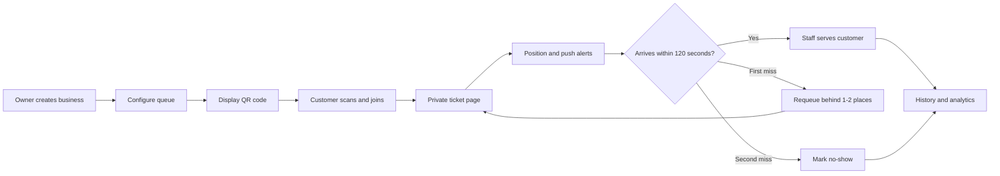

# QueueLess

> A QR-first virtual queue for small businesses.

QueueLess lets a café, salon, clinic, or service counter replace a physical waiting line with a lightweight browser flow. The business creates a queue and displays its QR code; customers scan, receive a private ticket, leave the premises if they want, and return when their turn approaches.

## Status

| Area | State |
| --- | --- |
| Core queue lifecycle | Working |
| Owner and staff dashboard | Working |
| QR-based customer joining | Working |
| Queue settings and analytics | Working |
| Push notifications | Implemented; requires VAPID configuration |
| Arrival window and requeue/no-show rules | Implemented; requires latest migration |
| Automated tests | Initial unit coverage |
| Production readiness | Not yet complete |

## Product flow



## What is included

| Role | Main capabilities |
| --- | --- |
| Owner | Create a business, configure queues, manage staff, operate queues, view analytics |
| Staff | Operate assigned queues and update ticket states |
| Customer | Join through QR, track position, receive alerts, confirm arrival, leave the queue |

## Technology

| Layer | Technology |
| --- | --- |
| Web application | Next.js 15, React 19, TypeScript |
| Data and auth | Supabase PostgreSQL, Auth, RLS, Realtime |
| Validation and utilities | Zod, QRCode |
| Notifications | Web Push with VAPID |
| Quality | ESLint, TypeScript, Prettier, Vitest |
| Deployment target | Vercel |

QueueLess is intentionally one full-stack Next.js application. There is no separate Express server or custom authentication service.

## Quick start

### Requirements

- Node.js LTS and npm
- A Supabase project
- Optional: VAPID keys for browser push notifications

```powershell
git clone https://github.com/Aaryan2R/QueueLess.git
cd QueueLess
npm install
Copy-Item .env.example .env.local
```

Add the values described in [docs/development.md](docs/development.md), then start the app:

```powershell
npm run dev
```

Open `http://localhost:3000`, create an owner account, create a business, and use its generated queue QR/link.

## Verification commands

```powershell
npm run test
npm run lint
npm run typecheck
npm run build
```

## Repository map

```text
QueueLess/
├── src/app/                 Next.js routes, pages, dashboard and customer UI
├── src/lib/                 Supabase clients, services, validation and security
├── supabase/migrations/     Ordered database schema and queue-state migrations
├── supabase/seed.sql        Optional local/demo seed data
├── tests/                   Vitest unit tests
├── public/                  Browser assets and service worker
├── docs/                    Product, architecture, operations and audit documentation
├── middleware.ts            Session refresh and request middleware
├── next.config.ts           Next.js security/build configuration
└── package.json             Scripts and dependencies
```

## Documentation

| Document | Purpose |
| --- | --- |
| [Documentation home](docs/README.md) | Navigation and current project summary |
| [Product guide](docs/product.md) | Purpose, roles, scope and user journeys |
| [Architecture](docs/architecture.md) | System diagram, data flow, routes and database model |
| [Development guide](docs/development.md) | Setup, environment, migrations and validation |
| [Security guide](docs/security.md) | Tenant isolation, secrets, controls and open hardening |
| [Operations guide](docs/operations.md) | Demo runbook and production checklist |
| [Roadmap](docs/roadmap.md) | Completed work and next priorities |
| [Audit archive](docs/audits/) | Historical reviews and independent audit briefs |

## Security note

Never commit `.env.local`, Supabase secret/service-role keys, private VAPID keys, access tokens, or customer data. Public ticket URLs are bearer credentials and must be treated as private.
