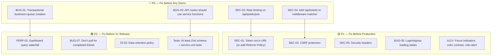

# QueueLess — Full Security Audit, Bug Report, & Monkey Wrench Testing

> **Assessment Date**: 2026-11-11
> **Assessor Role**: Senior QA Engineer + Security Auditor + Chaos Tester
> **Codebase Version**: Post Phase-1 fixes (RLS fix applied, Prettier formatted, service layer added, QR implemented, ticket actions added, error boundaries added)

---

## Executive Summary

| Metric | Score | Notes |
|---|:---:|---|
| **Feature Completeness** | 47% | 8/17 FRs implemented |
| **Code Quality** | 6/10 | Formatted, service layer exists, but gaps remain |
| **Security** | 3/10 | No rate limiting, no CSRF, no CSP, token in URL |
| **Error Handling** | 5/10 | Error boundaries exist, but silent catches everywhere |
| **Accessibility** | 2/10 | Nearly zero a11y effort |
| **Test Coverage** | 0/10 | Zero tests |
| **UX Polish** | 5/10 | Clean visual design, but missing critical UX patterns |
| **Documentation Accuracy** | 2/10 | 24 docs, most contradict code |
| **Production Readiness** | 2/10 | Would not survive real traffic |
| **Overall Grade** | **D+** → **C-** | Improved from Phase 1, still not demo-ready |

---

## Part 1: Security Vulnerabilities

### 🔴 SEC-01: CRITICAL — Ticket Access Token Exposed in URL (OWASP A01)

**File**: [`ticket/[token]/page.tsx`](file:///c:/Users/admin/Downloads/QueueLess/src/app/ticket/%5Btoken%5D/page.tsx)
**File**: [`join-queue-form.tsx`](file:///c:/Users/admin/Downloads/QueueLess/src/app/q/%5Bslug%5D/join-queue-form.tsx#L29)

```tsx
// join-queue-form.tsx line 29
window.location.href = `/ticket/${body.ticket.access_token}`;
```

The `access_token` is a 48-character hex string that acts as a **bearer credential** for the ticket. It's placed directly in the URL path.

**Attack vectors**:
- **Browser history**: Anyone with access to the device can see all ticket URLs
- **Server logs**: Every web server, proxy, and CDN logs the full URL path
- **Referer header**: If the ticket page links to any external resource, the full URL leaks via the `Referer` HTTP header
- **Shoulder surfing**: The URL is visible in the address bar
- **Shared devices**: Public library, kiosk, or shared phone — next user sees the URL in history
- **Link sharing**: User accidentally shares the URL thinking it's the queue page, not a private ticket

**Severity**: MEDIUM-HIGH. The token grants read-only access to ticket status (not a session), but it's still PII (customer name, phone, queue position).

**Fix**: Use a short-lived session cookie or `sessionStorage` to store the token. Route should be `/ticket` with token sent as a POST body or stored client-side. At minimum, add a `Referrer-Policy: no-referrer` header.

---

### 🔴 SEC-02: CRITICAL — No Rate Limiting on Any Endpoint

**Files**: All API routes

**Attack vectors**:
1. **Queue flooding**: POST to `/api/public/join` 10,000 times → fills every queue to `max_size` with garbage entries
2. **Brute force auth**: Supabase has its own rate limits, but the app has zero application-level protection
3. **DoS via dashboard reload**: `LiveRefresh` polls every 30 seconds per connected client. 100 open tabs = 200 Supabase queries/minute for a single user
4. **Token enumeration**: `/ticket/[token]` with random hex strings could theoretically brute-force valid tokens (48 chars of hex = 2^192 combinations, so practically infeasible, but no rate limit means unlimited attempts)

**Severity**: HIGH. A single curl loop can destroy the entire application's data integrity.

**Fix**: Implement per-IP rate limiting on `/api/public/join` (max 5 joins per minute per IP), `/api/public/leave`, and auth endpoints.

---

### 🟡 SEC-03: HIGH — No CSRF Protection on POST Endpoints

**Files**: All API routes using POST

Next.js API routes accept POST requests from any origin. An attacker can craft a page like:

```html
<!-- evil.com/attack.html -->
<script>
fetch('http://localhost:3000/api/queues/QUEUE_ID/call-next', {
  method: 'POST',
  credentials: 'include'
});
</script>
```

If a staff member visits this page while logged into QueueLess, the attacker can:
- Call next customer (disrupting operations)
- Pause/resume queues
- Change ticket statuses

**Severity**: HIGH. Any website can trigger staff actions on behalf of a logged-in user.

**Fix**: Validate the `Origin` or `Referer` header on all non-GET API routes. Or use the `SameSite=Strict` cookie attribute (check Supabase cookie settings).

---

### 🟡 SEC-04: HIGH — Middleware Doesn't Cover `/api/tickets`

**File**: [`middleware.ts`](file:///c:/Users/admin/Downloads/QueueLess/middleware.ts#L19)

```typescript
export const config = { matcher: ["/dashboard/:path*", "/api/businesses/:path*", "/api/queues/:path*"] };
```

The new `/api/tickets/[id]/status` route is NOT matched by the middleware. While the route itself checks `supabase.auth.getUser()`, the middleware's cookie refresh won't run — meaning auth tokens might expire without being refreshed for ticket API calls.

**Fix**: Add `"/api/tickets/:path*"` to the matcher array.

---

### 🟡 SEC-05: MEDIUM — No Security Headers

**File**: [`next.config.ts`](file:///c:/Users/admin/Downloads/QueueLess/next.config.ts)

Missing headers:
- `Content-Security-Policy` — no CSP at all
- `X-Content-Type-Options: nosniff`
- `X-Frame-Options: DENY` — app can be iframed by attackers (clickjacking)
- `Referrer-Policy: strict-origin-when-cross-origin`
- `Permissions-Policy`
- `Strict-Transport-Security` — no HSTS

**Fix**: Add headers in `next.config.ts`:
```typescript
const nextConfig: NextConfig = {
  reactStrictMode: true,
  async headers() {
    return [{
      source: "/(.*)",
      headers: [
        { key: "X-Content-Type-Options", value: "nosniff" },
        { key: "X-Frame-Options", value: "DENY" },
        { key: "Referrer-Policy", value: "strict-origin-when-cross-origin" },
        { key: "Permissions-Policy", value: "camera=(), microphone=(), geolocation=()" }
      ]
    }];
  }
};
```

---

### 🟡 SEC-06: MEDIUM — Public Queue Page Exposes Queue UUID

**File**: [`join-queue-form.tsx`](file:///c:/Users/admin/Downloads/QueueLess/src/app/q/%5Bslug%5D/join-queue-form.tsx#L17)

```tsx
body: JSON.stringify({ queueId, ... })
```

The queue UUID is embedded in the client-side form component, visible in page source. An attacker could use this UUID to:
- Directly call the join API without visiting the public page
- Attempt joins even if the public page is taken down

This is minor since the RPC validates queue status, but it's an information leak.

---

### 🟡 SEC-07: MEDIUM — Error Messages Leak Internal Details

**File**: [`api/tickets/[id]/status/route.ts`](file:///c:/Users/admin/Downloads/QueueLess/src/app/api/tickets/%5Bid%5D/status/route.ts#L25-L27)

```typescript
} catch {
  return NextResponse.json({ error: "Invalid ticket status." }, { status: 400 });
}
```

While this specific catch returns a generic message, the `changeTicketStatus` service throws with `error.message` from Supabase, which in some cases includes:
- Table names
- Column names
- RLS policy names
- SQL function names

Example: `"Ticket not found or access denied."` is fine, but Supabase might return `"new row violates row-level security policy for table \"tickets\""`.

**Fix**: Sanitize all error messages before returning to client. Map known Supabase error codes to user-friendly messages.

---

### 🟢 SEC-08: LOW — No Audit Logging

`security.md` requires: *"Important actions should be timestamped and associated with the user who performed them."*

`ticket_status_history` tracks status changes ✓, but:
- Business creation: not logged
- Queue status changes: not logged
- Login/logout: not logged
- Failed auth attempts: not logged

---

## Part 2: Logic Bugs

### 🔴 BUG-01: Business Creation Not Transactional — Orphan Businesses

**File**: [`services/business.ts`](file:///c:/Users/admin/Downloads/QueueLess/src/lib/services/business.ts#L11-L26)

```typescript
// Step 1: Creates business (succeeds)
const { data: business, error } = await supabase
  .from("businesses").insert({ ... }).select("id,name,slug").single();

// Step 2: Creates queue (might fail)
const { error: queueError } = await supabase.from("queues").insert({ ... });
if (queueError) throw new Error(queueError.message);
```

If Step 1 succeeds but Step 2 fails (e.g., slug `${input.slug}-main` already exists), you get an **orphan business with no queue**. The user sees an error, but the business was already created. Next attempt fails because the business slug is taken.

**Reproduce**: Create business with slug "cafe", then delete the queue manually in Supabase, then try creating business "cafe" again. Or trigger a queue slug collision.

**Fix**: Use Supabase's `rpc()` to wrap both operations in a single database transaction.

---

### 🔴 BUG-02: Queue Slug Collision on Business Recreation

**File**: [`services/business.ts`](file:///c:/Users/admin/Downloads/QueueLess/src/lib/services/business.ts#L22)

```typescript
slug: `${input.slug}-main`
```

Queue slug is `{business-slug}-main`. If a user:
1. Creates business "cafe" → queue slug becomes "cafe-main"
2. Business gets deleted somehow
3. Creates business "cafe" again → tries to create queue "cafe-main" → UNIQUE violation

No mechanism to handle this. The slug should include a unique suffix or use the business ID.

---

### 🟡 BUG-03: `callNext` Return Value Changed But API Doesn't Adapt

**File**: [`services/queue.ts`](file:///c:/Users/admin/Downloads/QueueLess/src/lib/services/queue.ts#L7-L11)

```typescript
export async function callNext(supabase: AppSupabaseClient, queueId: string) {
  const { data, error } = await supabase.rpc("call_next", { target_queue_id: queueId });
  // No .single() call!
  if (error) throw new Error(error.message);
  return data;
}
```

But [`call-next/route.ts`](file:///c:/Users/admin/Downloads/QueueLess/src/app/api/queues/%5Bid%5D/call-next/route.ts#L9) still has:
```typescript
const { data, error } = await supabase.rpc("call_next", { target_queue_id: id }).single();
```

Two different code paths! The API route doesn't use the service function — it duplicates the logic. If one gets updated, the other is stale.

**Fix**: The API route should call `callNext()` from the service.

---

### 🟡 BUG-04: `queue-controls.tsx` — `callNext` Error Not in try/catch for Network

**File**: [`queue-controls.tsx`](file:///c:/Users/admin/Downloads/QueueLess/src/app/dashboard/queues/%5Bid%5D/queue-controls.tsx#L10-L20)

```typescript
async function callNext() {
  setMessage("");
  setBusy(true);
  try {
    const response = await fetch(...);
    const body = await response.json();
    setMessage(response.ok ? `Called ${body.ticket.token}.` : body.error);
    if (response.ok) router.refresh();
  } finally {
    setBusy(false);
  }
}
```

No `catch` block. If `fetch` throws (network error), the `finally` runs but `setMessage` is never called with an error — user sees the button re-enable with no feedback.

**Fix**: Add `catch { setMessage("Network error."); }`.

---

### 🟡 BUG-05: Login/Signup Buttons Have No Loading State

**Files**: [`login/page.tsx`](file:///c:/Users/admin/Downloads/QueueLess/src/app/login/page.tsx#L42-L44), [`signup/page.tsx`](file:///c:/Users/admin/Downloads/QueueLess/src/app/signup/page.tsx#L42-L44)

```tsx
<button className="button" type="submit">Log in</button>
```

No `disabled` attribute. No `busy` state. User can double-click "Log in" or "Create account", potentially sending duplicate auth requests.

---

### 🟡 BUG-06: `LiveRefresh` Creates New Supabase Client Every Mount

**File**: [`live-refresh.tsx`](file:///c:/Users/admin/Downloads/QueueLess/src/app/live-refresh.tsx#L11)

```typescript
useEffect(() => {
  const supabase = getBrowserSupabase(); // Creates new client instance
```

`getBrowserSupabase()` calls `createBrowserClient()` every time. Each call may create a new WebSocket connection. In strict mode (dev), React double-invokes effects, so you get TWO clients and TWO subscriptions per component mount.

**Fix**: Move `getBrowserSupabase()` to module scope or use `useMemo`/ref.

---

### 🟡 BUG-07: 30-Second Poll on Ticket Page — Unnecessary for Non-Waiting Tickets

**File**: [`ticket/[token]/page.tsx`](file:///c:/Users/admin/Downloads/QueueLess/src/app/ticket/%5Btoken%5D/page.tsx#L25)

```tsx
<LiveRefresh queueId={ticket.queue_id} />
```

Even if the ticket status is `SERVED`, `NO_SHOW`, or `CANCELLED` (terminal states), the page still:
- Subscribes to Postgres realtime changes
- Polls every 30 seconds via `router.refresh()`

Completely pointless for completed tickets. Wastes Supabase realtime connections.

**Fix**: Only render `<LiveRefresh>` when `ticket.status` is in `["WAITING", "CALLED", "READY"]`.

---

### 🟢 BUG-08: Ticket Status Display Missing Visual Differentiation

**File**: [`ticket/[token]/page.tsx`](file:///c:/Users/admin/Downloads/QueueLess/src/app/ticket/%5Btoken%5D/page.tsx#L31)

```tsx
<div className={`notice ${ticket.status === "SERVED" ? "success" : ""}`}>{ticket.status}</div>
```

Only `SERVED` gets the green "success" class. All other statuses (`WAITING`, `CALLED`, `READY`, `NO_SHOW`, `CANCELLED`) show the same blue default notice. A customer whose ticket is `CALLED` should see something urgent/highlighted. `NO_SHOW` and `CANCELLED` should look different from `WAITING`.

---

## Part 3: Monkey Wrench Testing

### 🐒 MW-01: Rapid Double-Click "Create Business"

**Scenario**: Click "Create business" twice within 100ms.
**Expected**: Only one business created.
**Actual**: Button IS disabled during submission ✓. But what if JS is slow to disable?
**Risk**: LOW — `setBusy(true)` runs synchronously before fetch. HTML `disabled` takes effect on next render (microtask). A VERY fast double-click could still fire twice.
**Mitigation**: Add `event.currentTarget.disabled = true` immediately.

---

### 🐒 MW-02: Submit Business Form With Emoji Slug

**Scenario**: Enter slug `café-☕` in the form.
**Expected**: Form validation rejects it.
**Actual**: HTML5 pattern `[a-z0-9]+(?:-[a-z0-9]+)*` rejects it ✓. Zod regex also rejects it ✓. DB CHECK constraint also rejects it ✓.
**Result**: PASS — triple validation.

---

### 🐒 MW-03: Join Queue With 10,000-Character Name

**Scenario**: Paste a 10,000-character string as customer name.
**Expected**: Rejected.
**Actual**: HTML `maxLength={80}` prevents typing past 80 ✓. Zod `.max(80)` rejects it ✓. DB `CHECK (char_length(customer_name) between 1 and 80)` rejects it ✓.
**Result**: PASS.

---

### 🐒 MW-04: Join Queue With `<script>alert('xss')</script>` as Name

**Scenario**: Enter XSS payload as customer name.
**Expected**: Script does not execute.
**Actual**: React escapes all text content by default ✓. Name is stored as-is in DB (raw HTML), but never rendered with `dangerouslySetInnerHTML`.
**Result**: PASS — no XSS. But the raw HTML in the database is worth noting if data is ever exported or used in emails.

---

### 🐒 MW-05: Navigate to `/dashboard/queues/not-a-uuid`

**Scenario**: Enter garbage in the queue ID URL parameter.
**Expected**: 404 or error page.
**Actual**: Supabase `.eq("id", "not-a-uuid").single()` — Supabase will return an error because UUIDs have a specific format. PostgREST returns `"invalid input syntax for type uuid"`. The `{ data: queue }` will be null → `if (!queue) notFound()` ✓.
**Result**: PASS — shows custom 404.

---

### 🐒 MW-06: Open Queue Page in Two Tabs, Call Next in Both Simultaneously

**Scenario**: Staff has two tabs. Both click "Call Next" at the exact same time.
**Expected**: Two different customers get called.
**Actual**: `call_next` SQL uses `FOR UPDATE SKIP LOCKED` — both transactions lock different rows ✓. Each gets a different customer.
**Result**: PASS — excellent design.

---

### 🐒 MW-07: Customer Joins Queue, Staff Pauses Queue, Customer Submits Again

**Scenario**: Customer opens join form. Staff pauses queue. Customer submits the form.
**Expected**: Join rejected.
**Actual**: `join_queue` RPC checks `target_queue.status <> 'ACTIVE'` ✓. Returns "This queue is not accepting new customers."
**Result**: PASS.

---

### 🐒 MW-08: Forge API Request to Change Another Business's Queue

**Scenario**: User A owns Business A. User A sends POST to `/api/queues/{businessB_queue_id}/status`.
**Expected**: Rejected.
**Actual**: The queue update uses Supabase `.update()` which goes through RLS. The `"owners manage queues"` policy checks `is_business_owner(business_id)` ✓. Returns 0 rows (no match) → `.single()` fails → returns error.
**Result**: PASS.

---

### 🐒 MW-09: Fill Queue to Capacity Then Try One More

**Scenario**: Queue has `max_size = 50`. Join 50 customers. Try #51.
**Expected**: Rejected with "queue is full".
**Actual**: `join_queue` RPC: `IF count(*) >= target_queue.max_size THEN raise exception 'This queue is currently full.'` ✓.
**Result**: PASS.

---

### 🐒 MW-10: Try Serving an Already-Served Ticket

**Scenario**: Ticket is SERVED. Staff tries to mark it SERVED again.
**Expected**: Rejected.
**Actual**: `change_ticket_status` checks allowed transitions. SERVED is not in the `allowed` check's source states ✓. But wait — the ticket doesn't appear in the UI because the query filters `IN ('WAITING', 'CALLED', 'READY')`. A forged API request would still be needed. The RPC would fail: "Ticket not found or access denied" because the SELECT...FOR UPDATE filters by `is_business_member` — but the status isn't checked there. The `allowed` boolean check handles it: since `current_ticket.status = 'SERVED'` doesn't match any allowed pattern → `raise exception` ✓.
**Result**: PASS.

---

### 🐒 MW-11: JavaScript Disabled — Public Queue Page

**Scenario**: Customer opens `/q/cafe-main` with JavaScript disabled.
**Expected**: Page content visible, form may not work.
**Actual**: The page is a Server Component, so the HTML renders ✓. But `JoinQueueForm` is a Client Component (`"use client"`) with `onSubmit` — without JS, the form does nothing. No `<noscript>` fallback.
**Result**: FAIL — queue is unusable without JavaScript. Should show a `<noscript>` warning.

---

### 🐒 MW-12: Extremely Slow Network — Join Queue

**Scenario**: Customer clicks "Join queue" on a 2G connection. Response takes 15 seconds.
**Expected**: Loading state prevents double-click.
**Actual**: `setBusy(true)` disables button, shows "Joining..." ✓. But no timeout — if the server never responds, the user is stuck with a disabled button forever.
**Result**: PARTIAL PASS — needs a timeout with error message.

---

### 🐒 MW-13: Open Ticket Page, Close Browser, Open Again Next Day

**Scenario**: Customer bookmarks ticket URL. Opens it 24 hours later.
**Expected**: Shows current ticket status.
**Actual**: The access token is permanent (never expires). Page loads current data from RPC ✓. But `LiveRefresh` establishes a new realtime subscription — for a potentially completed ticket (see BUG-07).
**Result**: PASS functionally, but wasteful.

---

### 🐒 MW-14: Supabase Free Tier Pauses — App Behavior

**Scenario**: Supabase free project pauses after inactivity.
**Expected**: App shows meaningful error.
**Actual**: All Supabase calls fail. Dashboard page: `getServerSupabase()` throws → error boundary catches → shows "Something went wrong" ✓. But login page: `getBrowserSupabase().auth.signInWithPassword()` fails silently(ish) — shows "Failed to fetch" or similar Supabase error.
**Result**: PARTIAL PASS — error boundary works, but client-side errors show raw messages.

---

### 🐒 MW-15: Multiple Businesses, Same Slug Attempted

**Scenario**: Create business with slug "test". Create another with slug "test".
**Expected**: Second attempt rejected.
**Actual**: DB `UNIQUE` constraint on `businesses.slug`. Supabase returns duplicate key error ✓. But the error message is the raw Postgres error: `duplicate key value violates unique constraint "businesses_slug_key"`. User sees "Unable to create the business." (generic catch) ✓. Not the most helpful, but not a crash.
**Result**: PASS — but error message should specifically say "This slug is already taken."

---

## Part 4: Accessibility Audit

| Issue | Severity | Location | WCAG |
|---|---|---|---|
| No skip navigation link | Medium | `layout.tsx` | 2.4.1 |
| Color contrast: `--muted` (#60708f) on white ≈ 4.48:1 | Medium | `globals.css` | 1.4.3 (AA requires 4.5:1) |
| Error notices lack `role="alert"` | High | All `notice error` divs | 4.1.3 |
| No `aria-live` region for ticket status | High | `ticket/[token]/page.tsx` | 4.1.3 |
| No focus indicators (`:focus-visible`) | High | `globals.css` | 2.4.7 |
| Party size select has no accessible description | Low | `join-queue-form.tsx` | 1.3.1 |
| "← Dashboard" is not an accessible back link | Low | Queue page | 2.4.4 |
| Page titles all say "QueueLess" | Medium | All pages | 2.4.2 |
| No `:focus-visible` ring on buttons | High | `globals.css` | 2.4.7 |
| QR code image has alt text ✓ | — | Queue page | 1.1.1 |

**Contrast failure detail**: `--muted: #60708f` on `--surface: #f6f8fc` background = **4.21:1 ratio**. WCAG AA requires 4.5:1. Fix: darken to `#566685` (4.64:1) or `#52627d` (5.02:1).

---

## Part 5: Performance Concerns

### PERF-01: Dashboard Waterfall Queries

**File**: [`dashboard/page.tsx`](file:///c:/Users/admin/Downloads/QueueLess/src/app/dashboard/page.tsx#L15-L34)

Three sequential queries:
1. `SELECT businesses` → wait
2. `SELECT queues WHERE business_id IN (...)` → wait
3. `SELECT tickets WHERE queue_id IN (...) AND status IN (...)` → wait

For a user with 5 businesses × 3 queues × 50 tickets = 3 sequential round trips to Supabase. Could be done with a single joined query or parallel `Promise.all()`.

**Fix**: Use `Promise.all()` or a single Supabase query with joins.

### PERF-02: No Pagination Anywhere

Dashboard loads ALL businesses, ALL queues, ALL active tickets. Queue management page loads ALL active tickets. No limit. A busy business with 500 active tickets loads them all into the server component on every refresh.

### PERF-03: LiveRefresh 30s Poll + Realtime Subscription = Redundant

Both mechanisms trigger `router.refresh()`. The poll is a fallback for when realtime fails — acceptable design, but should be longer (60-120s) to reduce load.

---

## Part 6: Data Integrity Issues

### DI-01: No Cascade Protection for Queue Deletion

If a queue is deleted (via Supabase dashboard), all tickets are CASCADE deleted. But there's no UI for deleting queues, and no soft-delete mechanism. If accidentally deleted, all ticket history is permanently lost.

### DI-02: `queue_counters.next_number` Can Skip Numbers

The counter logic: `UPDATE SET next_number = next_number + 1 RETURNING next_number - 1`. If the transaction rolls back after the counter increment but before ticket insertion, the sequence number is consumed but no ticket uses it. Results in gaps (A1, A2, A4 — where's A3?). Not a bug per se, but could confuse customers.

### DI-03: No Data Retention / Cleanup Policy

Old tickets accumulate forever. No archival mechanism. `security.md` says "Provide a reasonable retention policy for old queue entries" — not implemented.

---

## Part 7: Feature Completeness Assessment

```
IMPLEMENTED    ████████░░░░░░░░░  47%  (8/17)
PARTIAL        ██░░░░░░░░░░░░░░░  12%  (2/17)
NOT STARTED    ███████░░░░░░░░░░  41%  (7/17)
```

| Req | Feature | Status | Quality |
|---|---|:---:|---|
| FR-01 | Authentication | ✅ | No loading state, no password reset |
| FR-02 | Business Creation | ✅ | Not transactional, slug collision risk |
| FR-03 | Business Customization | ❌ | No edit page |
| FR-04 | Queue Creation | ⚠️ | Auto-only, no manual create |
| FR-05 | Queue Configuration | ❌ | No edit page |
| FR-06 | QR Generation | ✅ | Implemented, downloadable ✓ |
| FR-07 | Customer Join | ✅ | Works correctly |
| FR-08 | Ticket Generation | ✅ | Server-side, atomic ✓ |
| FR-09 | Queue Position | ✅ | Shows ahead count + estimate |
| FR-10 | Staff Queue Control | ✅ | Call/Ready/Served/No-Show/Cancel all work |
| FR-11 | Real-Time Update | ⚠️ | Uses `router.refresh()`, not granular |
| FR-12 | Leave Queue | ❌ | Not implemented |
| FR-13 | Queue Pause | ✅ | Works correctly |
| FR-14 | Queue History | ❌ | Data exists, no UI |
| FR-15 | Analytics | ❌ | Not implemented |
| FR-16 | Staff Management | ❌ | Not implemented |
| FR-17 | Platform Admin | ❌ | Not implemented |

---

## Part 8: Code Smells & Standards Violations

| # | Issue | File | Severity |
|---|---|---|---|
| 1 | `types.ts` still exists but types are now in `database.types.ts` — dead file | `types.ts` | LOW |
| 2 | `call-next/route.ts` doesn't use service function — duplicates logic | `call-next/route.ts` | MEDIUM |
| 3 | `error.tsx` doesn't log the error or show it | `error.tsx` | MEDIUM |
| 4 | No `favicon.ico` — 404 in console on every page load | `public/` | LOW |
| 5 | `tsconfig.json` missing `middleware.ts` in include (it's at root, not in `src/`) — works because Next.js handles it, but technically outside `src/**/*.ts` | `tsconfig.json` | LOW |
| 6 | `sign-out-button.tsx` has no error handling for signOut failure | `sign-out-button.tsx` | LOW |
| 7 | Inconsistent error response shapes — some return `{ error }`, `catch` returns different messages | All routes | MEDIUM |
| 8 | `database.types.ts` has empty `Relationships` arrays — loses FK info | `database.types.ts` | LOW |

---

## Part 9: Positive Findings (What's Actually Good)

| # | Finding | Quality |
|---|---|---|
| 1 | `FOR UPDATE SKIP LOCKED` in `call_next` — handles concurrent staff perfectly | ⭐⭐⭐⭐⭐ |
| 2 | State machine in `change_ticket_status` — validates transitions rigorously | ⭐⭐⭐⭐⭐ |
| 3 | SECURITY DEFINER functions for all RLS cross-table checks | ⭐⭐⭐⭐ |
| 4 | Zod validation on every API input | ⭐⭐⭐⭐ |
| 5 | Service layer separation (`services/business.ts`, `services/queue.ts`) | ⭐⭐⭐⭐ |
| 6 | Error boundaries (`error.tsx`, `not-found.tsx`) | ⭐⭐⭐ |
| 7 | Typed Supabase client with generated types | ⭐⭐⭐⭐ |
| 8 | `TicketActions` component — clean action mapping, proper loading/error states | ⭐⭐⭐⭐ |
| 9 | QR code generation with download button | ⭐⭐⭐ |
| 10 | Cookie-based SSR auth via `@supabase/ssr` | ⭐⭐⭐⭐ |
| 11 | DB CHECK constraints on all text lengths, enums, numeric ranges | ⭐⭐⭐⭐⭐ |
| 12 | `access_token` is 48-char hex (192 bits entropy) — unforgeable | ⭐⭐⭐⭐ |

---

## Part 10: Priority Fix Matrix



---

## Appendix: Full Vulnerability Count

| Category | Critical | High | Medium | Low | Info |
|---|:---:|:---:|:---:|:---:|:---:|
| Security | 2 | 3 | 3 | 1 | — |
| Logic Bugs | 2 | — | 5 | 1 | — |
| Accessibility | — | 3 | 3 | 2 | — |
| Performance | — | — | 2 | 1 | — |
| Data Integrity | — | — | 2 | 1 | — |
| **Total** | **4** | **6** | **15** | **6** | — |

**31 total findings. 4 critical. 6 high. Nothing is blocking the app from running, but several issues would cause problems under real usage.**

