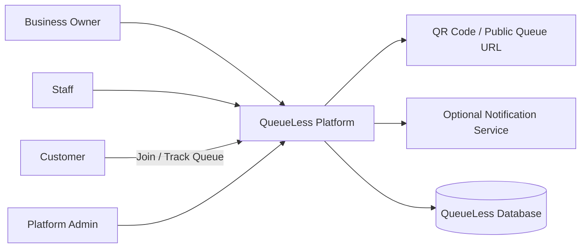

# QueueLess – System Context

## Context Summary
QueueLess sits between businesses and their waiting customers. Businesses use the platform to configure and operate queues. Customers use a public queue page to join and track a queue. The platform stores queue, customer, ticket, staff, and history data.

## External Actors
| Actor | Interaction |
|---|---|
| Platform Admin | Manages registered businesses and platform-level settings |
| Business Owner | Creates business, queues, branding and staff |
| Staff | Operates active queues and updates ticket states |
| Customer | Joins queue, checks position, leaves queue, receives status |
| QR Generator | Produces a QR code for a public queue URL |
| Notification Service | Optional channel for email/SMS/push updates |

## System Boundary
Inside QueueLess:
- Authentication and authorization
- Business management
- Queue configuration
- Ticket generation
- Queue ordering
- Wait-time calculation
- Real-time status updates
- Staff management
- Queue history
- Analytics

Outside QueueLess:
- Physical business operations
- Actual tables/service counters
- Customer's QR scanning application/camera
- Optional third-party messaging providers

## Context Diagram (Conceptual)

## Key Context Assumption
The customer does not need a QueueLess account for the basic queue flow. A lightweight identity such as name and/or phone number is sufficient for a ticket.
