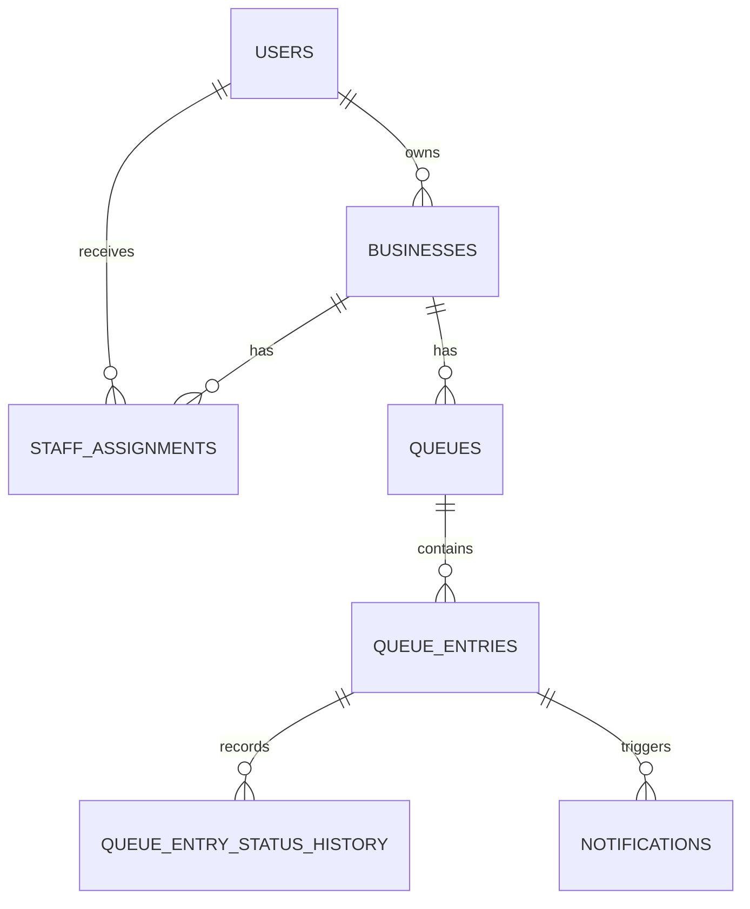

# QueueLess – Database Design

## Main Entities

### users
- id (PK)
- name
- email
- password_hash
- role
- status
- created_at
- updated_at

### businesses
- id (PK)
- owner_id (FK users.id)
- name
- slug
- category
- logo_url
- theme_config
- welcome_message
- contact_phone
- address
- status
- created_at
- updated_at

### staff_assignments
- id (PK)
- business_id (FK)
- user_id (FK)
- created_at
- status

### queues
- id (PK)
- business_id (FK)
- name
- description
- queue_type
- max_size
- average_service_minutes
- opening_time
- closing_time
- auto_no_show_minutes
- allow_customer_cancel
- status
- created_at
- updated_at

### queue_entries
- id (PK)
- queue_id (FK)
- token
- customer_name
- customer_phone
- party_size
- joined_at
- called_at
- ready_at
- served_at
- completed_at
- final_status

### queue_entry_status_history
- id (PK)
- queue_entry_id (FK)
- old_status
- new_status
- changed_by_user_id (nullable for system events)
- created_at

### notifications
- id (PK)
- queue_entry_id (FK)
- channel
- event_type
- recipient
- status
- created_at

## Relationships

## Database Rules
- Email should be unique for authenticated accounts.
- Business slug should be unique.
- Queue token should be unique within a queue cycle and preferably unique globally where practical.
- Foreign keys should enforce valid relationships.
- Use timestamps in UTC in storage; convert for display as needed.
- Do not store raw passwords.
