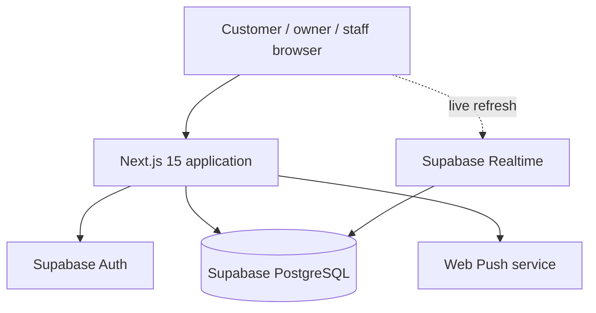
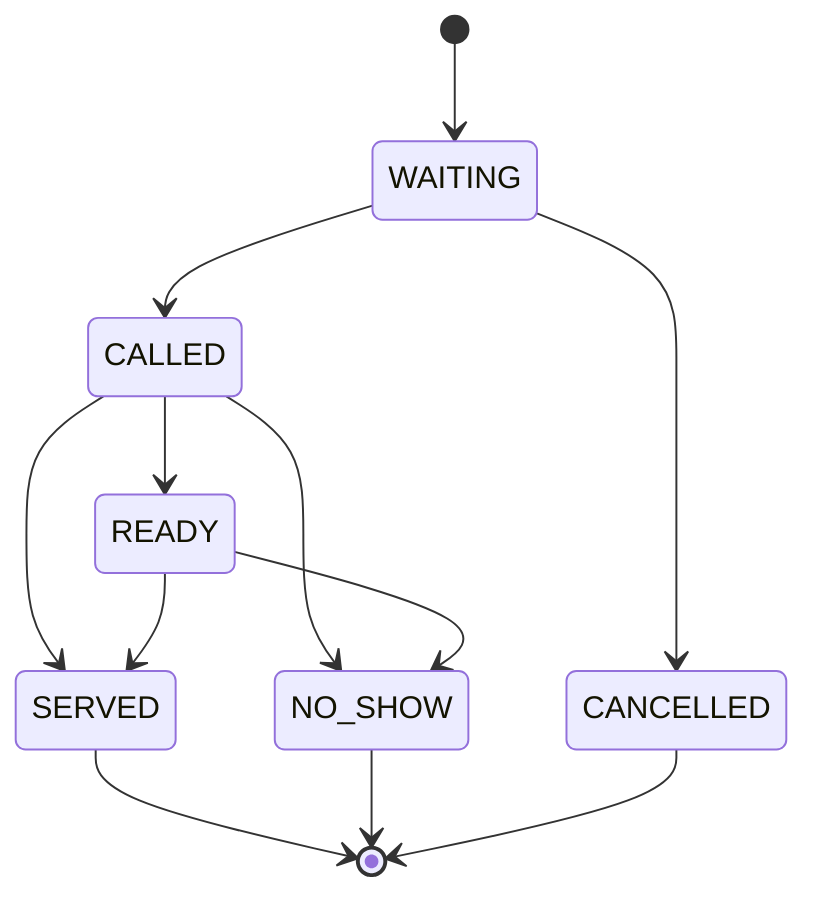
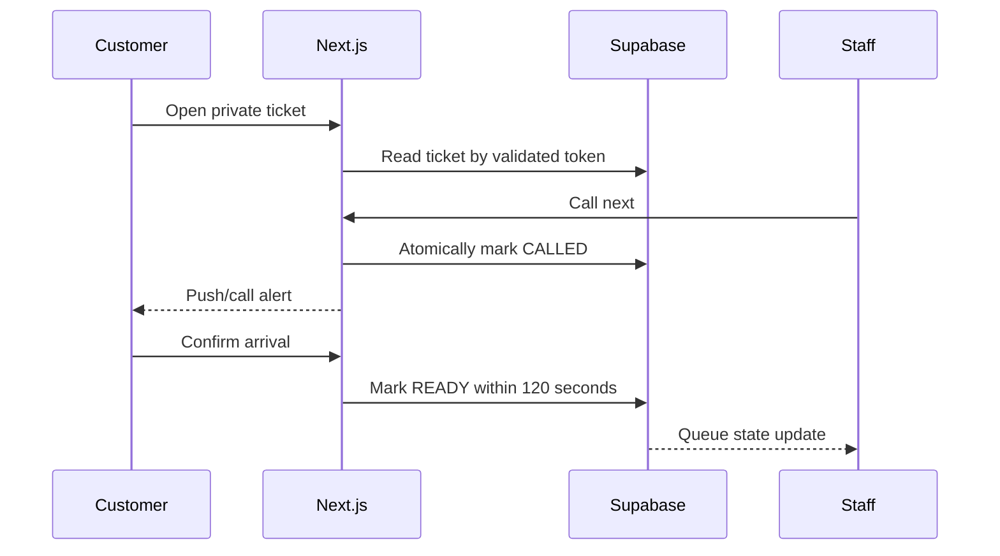

# Architecture

## Runtime shape

QueueLess is a single full-stack Next.js application. Next.js pages, server components, client components and route handlers share one deployment. Supabase is the source of truth for identity, authorization, queue state and history.

## Queue lifecycle

The database and server-side validation enforce transitions. The browser never decides queue order, capacity, token generation or authorization.

## Source layout

| Path | Responsibility |
| --- | --- |
| `src/app/` | Routes, pages, forms, dashboard and customer experience |
| `src/app/api/` | Authenticated and public route handlers |
| `src/lib/services/` | Business, queue and push service logic |
| `src/lib/security.ts` | Token validation, origin checks and rate limiting |
| `src/lib/database.types.ts` | Supabase-generated database types |
| `supabase/migrations/` | Ordered schema, RLS and queue business functions |
| `tests/` | Focused Vitest unit tests |
| `public/sw.js` | Push notification service worker |

## Data model

| Entity | Purpose |
| --- | --- |
| `businesses` | Tenant and owner-owned business profile |
| `queues` | Queue configuration and status |
| `tickets` | Customer queue entries and lifecycle timestamps |
| `ticket_status_history` | State transition history |
| `staff_assignments` | Owner-managed staff access |
| `push_subscriptions` | Browser push endpoints |
| `ticket_alerts` | Deduplicated proximity/call alert claims |

RLS policies and security-definer database functions enforce tenant boundaries and atomic queue mutations.

## API areas

| Area | Routes |
| --- | --- |
| Business | `/api/businesses`, `/api/businesses/[id]/staff` |
| Public customer | `/api/public/join`, `/api/public/leave`, `/api/public/ticket/*`, `/api/public/push/subscribe` |
| Queue operations | `/api/queues/[id]`, `/api/queues/[id]/call-next`, `/api/queues/[id]/status` |
| Ticket operations | `/api/tickets/[id]/status` |

## Data flow: customer arrival

